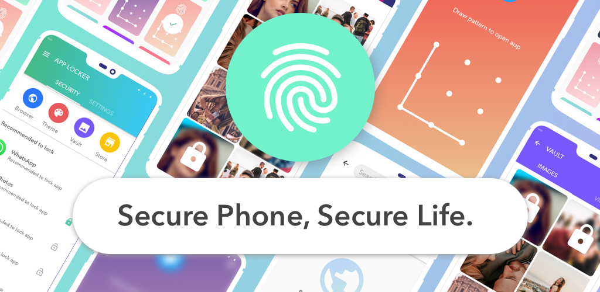
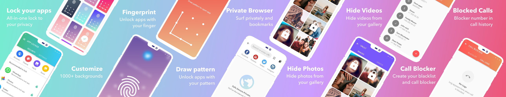

<p align="center">
  
</p>

I decided to open source my side project SecureBox. I'm sure most of us are suffering in some android's APIs. This application already has some user on Play Store market. So this open source project provides you the working solution about specific API's. Below, you will find a list of technical things to learn from this project.
[You can download app from Play Store](https://play.google.com/store/apps/details?id=com.momentolabs.app.security.applocker&hl=en)

# App Features
* App locker with pattern or fingerprint
* Lockout after five wrong patterns
* Vault for photos and videos (file encryption and decryption)
* Block calls (blacklist)
* Private browser
* Take a photo of intruders secretly (Camera 1 API)

# What can I learn
* RxJava 2
* Dagger 2 (dagger-android, processed with KSP)
* Room database with migrations and an exported schema
* ViewModel & LiveData
* WorkManager
* BiometricPrompt
* UsageStatsManager (which app is in the foreground)
* Foreground services on Android 14 and later (`specialUse` type)
* MVVM pattern using ViewState
* DataBinding: binding adapters, binding conversions and more
* Kotlin delegates
* File cryptography in Android
* CallScreeningService and the call screening role
* Custom browser with a hardened WebView
* Camera 1 API to take a photo without a preview
* Overlay window and activity from a background service
* Scoped storage: app specific folders and MediaStore delete requests
* Edge-to-edge, predictive back and per-app languages

# Building

The project needs JDK 17 and builds with the Gradle wrapper:

```
./gradlew assembleDevDebug
./gradlew testDevDebugUnitTest
```

`dev` installs next to the Play Store version with a `.dev` application id suffix. `prod` is
the store flavor.

The app targets Android 16 and runs on Android 6.0 (API 23) and later.

# Privacy

The app contains no ads, analytics or crash reporting SDKs. The lock pattern is stored as a
salted PBKDF2 hash, the app data is excluded from backups, and the lock screens, the vault and
the browser are hidden from screenshots.

# Third party code

The `patternlockview` module contains the sources of
[PatternLockView](https://github.com/aritraroy/PatternLockView) by Aritra Roy (Apache 2.0),
migrated to AndroidX, because the library is no longer published.

<p align="center">
  
</p>


License
--------


    Copyright 2019 Mert Şimşek

    Licensed under the Apache License, Version 2.0 (the "License");
    you may not use this file except in compliance with the License.
    You may obtain a copy of the License at

       http://www.apache.org/licenses/LICENSE-2.0

    Unless required by applicable law or agreed to in writing, software
    distributed under the License is distributed on an "AS IS" BASIS,
    WITHOUT WARRANTIES OR CONDITIONS OF ANY KIND, either express or implied.
    See the License for the specific language governing permissions and
    limitations under the License.
